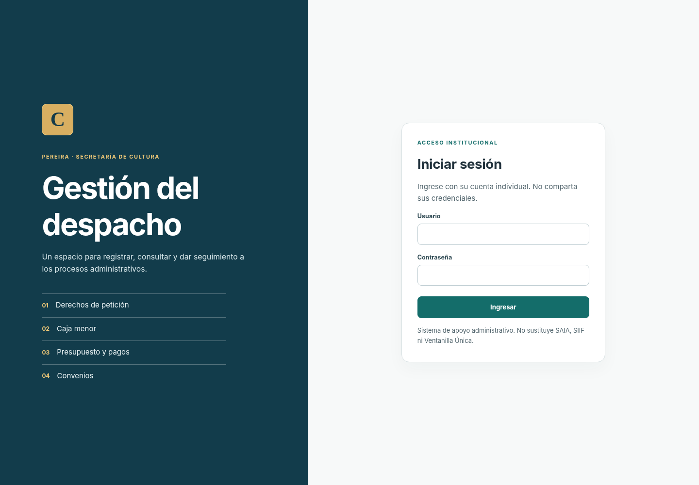

# Manual de administración
## Plataforma de Gestión del Despacho de la Secretaría de Cultura de Pereira

**Versión candidata 4.0 | Ingeniería de Software III**

Audiencia: administrador técnico y responsables de soporte. La arquitectura objetivo es React, Spring Boot y PostgreSQL. La modalidad local FastAPI/SQLite está destinada a demostración con datos ficticios. Los comandos de hosting de este manual son una guía de configuración, no evidencia de un servidor ya desplegado.

## 1. Puesta en servicio y ambientes

El administrador debe obtener autorización institucional, infraestructura, dominios y política de tratamiento de datos antes de utilizar información real. Los procedimientos SAIA, SIIF, Ventanilla Única, correo, Secretaría de Hacienda, Jurídica, Control Interno y Contaduría se mantienen externos.

Prepare staging con `deploy/staging.env.example` copiado a `.env.staging`. Defina `APP_PORT=8081`, `POSTGRES_PASSWORD`, `APP_SECRET` (32 bytes aleatorios como mínimo) y `ADMIN_PASSWORD` (compleja). Nunca use claves de demostración. En producción, use `.env.production`, `APP_PORT=8080` y credenciales diferentes. No versione esos archivos.

```powershell
docker compose --env-file .env.staging -p cultura-staging up --build -d
docker compose --env-file .env.staging -p cultura-staging ps
docker compose --env-file .env.staging -p cultura-staging logs -f app
```

Compruebe `http://127.0.0.1:8081/api/salud`. Pruebe flujos y permisos antes de habilitar usuarios. Para producción repita con `.env.production` y `-p cultura-production`, después de aprobación de staging. Los proyectos Compose tienen redes y volúmenes separados, por lo que no comparten registros ni archivos.

## 2. HTTPS y configuración del servidor

Use los dominios reales autorizados para producción y staging, con DNS hacia el servidor. Instale Caddy o el proxy institucional equivalente. `deploy/Caddyfile` contiene dos sitios que redirigen a 127.0.0.1:8080 y 127.0.0.1:8081. Configure las variables PROD_DOMAIN y STAGING_DOMAIN en el servicio del proxy o reemplace los marcadores por dominios reales; use la configuración aprobada por TI. Permita los puertos HTTP/HTTPS necesarios para el proceso de emisión y acceso, no exponga PostgreSQL ni los puertos internos de la aplicación a Internet.

Verifique en ambos dominios que HTTPS presenta un certificado válido, que HTTP redirige a HTTPS, que cada dominio muestra el entorno correcto y que el inicio de sesión y la carga/descarga de documentos funcionan. Renueve certificados y monitoree vencimientos. La configuración no emite ni acredita por sí misma un certificado; requiere DNS y hosting disponibles.

## 3. Primer acceso y administración de cuentas

Ingrese con admin y la contraseña configurada en ADMIN_PASSWORD al crear la base. Cambiar esa variable después no modifica una cuenta existente. Cambie la clave inicial desde Mi cuenta y vuelva a ingresar. Cree una cuenta individual por funcionario; no use una cuenta administrativa compartida en el trabajo ordinario.

En Usuarios, pulse Nuevo registro. Ingrese nombre de usuario, nombre completo, rol y contraseña temporal propia. Guarde y entregue la clave por un canal seguro; indique al usuario que la cambie en Mi cuenta. La plataforma no envía contraseñas por correo. Para editar una cuenta, seleccione Editar; cambie nombre, rol, estado activo o contraseña (deje la contraseña vacía si no la restablece). Los cambios de rol, estado o clave revocan sesiones existentes. No se permite desactivar o quitar el rol admin de la cuenta administrativa con la que se está operando.



## 4. Roles y permisos

La regla general es acceso por módulo y por acción crítica; el administrador tiene acceso total para soporte y pruebas, no para sustituir los controles institucionales. El secretario tiene lectura de todos los módulos y escritura de peticiones, caja y convenios. Debe usarse el rol más restrictivo que permita las tareas.

- Secretaria ejecutiva: registro, distribución informada y seguimiento de peticiones; no accede a caja, presupuesto ni convenios.
- Secretario(a) de Cultura: peticiones, autorización/seguimiento de compras y registro de firma, convenios; lectura de presupuesto y auditoría.
- Auxiliar administrativo: apertura, gastos, relaciones, envío a Control Interno, registro de reintegros/cierre y solicitudes presupuestales; no registra aprobación jurídica.
- Abogado delegado: peticiones y caja menor, incluyendo revisión jurídica y paso de revisión a firma; no administra usuarios.
- Profesional especializado de presupuesto, profesional universitario y técnico administrativo: registro y seguimiento presupuestal, incluidos descuentos e informes.
- Apoyo financiero: módulo de caja menor, registro de reintegros y cierre; no realiza aprobación jurídica.
- Administrador: todos los módulos, cuentas y auditoría. El secretario también puede consultar auditoría; otros roles no.

En caja menor los cambios de etapa se limitan a roles definidos por el servicio. Para confirmar que representan exactamente la asignación de funciones de la entidad, ejecute la prueba de aceptación con los responsables; son una decisión de diseño basada en el manual, no una autorización para ejercer funciones distintas.

## 5. Auditoría y seguimiento

Abra Auditoría con admin o secretario. Consulte los últimos 200 eventos y utilice el buscador. La API admite filtros de usuario/entidad y límite hasta 1.000. El registro guarda usuario, fecha/hora (UTC), acción, entidad, identificador y detalle. Se registran inicios exitosos/fallidos, creación, actualización, cambios de estado, carga/descarga, exportación y cambio de clave. La consulta de auditoría no es un mecanismo de firma digital ni un registro inalterable contra un administrador de base de datos.

Revise periódicamente accesos fallidos y cambios inusuales. Si una cuenta ya no pertenece a un funcionario autorizado, desactívela de inmediato y documente la novedad. Se aplica bloqueo temporal de inicio de sesión cuando hay diez intentos fallidos para el mismo usuario en diez minutos; use los canales institucionales para resolver bloqueos. Revise registros técnicos de servicio y espacio disponible.

## 6. Copias de seguridad y restauración

La información reside en dos conjuntos que deben respaldarse juntos: PostgreSQL y el volumen de documentos. Defina frecuencia, retención, responsable, cifrado y lugar de almacenamiento según la política institucional. Haga respaldo antes de cada migración y despliegue. No use datos reales en staging salvo autorización y anonimización.

Ejemplo de copia coherente en un servidor Linux/Bash, con permiso para detener temporalmente el servicio (sustituya staging por producción solo después de autorizarlo). Ejecute desde la raíz, en una ruta de backup protegida. Este procedimiento es una guía, no una copia ya realizada.

```bash
mkdir -p backups
chmod 700 backups
docker compose --env-file .env.staging -p cultura-staging stop app
docker compose --env-file .env.staging -p cultura-staging exec -T db pg_dump -U cultura -Fc cultura > backups/cultura.dump
docker run --rm -v cultura-staging_documentos:/data:ro -v "$PWD/backups:/backup" alpine tar -czf /backup/documentos.tar.gz -C /data .
docker compose --env-file .env.staging -p cultura-staging start app
```

Verifique tamaño, hash y apertura de los archivos; si falla algún comando, no dé por válido el respaldo. Pruebe restauración en un entorno nuevo y aislado: inicialice el proyecto de prueba, detenga app, restaure el dump con `pg_restore` contra una base vacía autorizada y extraiga el respaldo documental al volumen correspondiente, conservando permisos de lectura/escritura del usuario cultura. Nunca ejecute una restauración destructiva sobre producción sin un backup verificado, autorización y ventana de mantenimiento. Valide conteos, acceso y descarga de soportes antes de volver a habilitar usuarios.

## 7. Actualización de la plataforma

Revise el repositorio, dependencias y migraciones. Pruebe el build y las pruebas Java/PostgreSQL en staging. Tome backup, construya la imagen de la versión candidata y ejecute los criterios de aceptación con los responsables. Si se aprueba, despliegue la misma revisión en producción. No modifique V1 de Flyway si ya se aplicó; agregue migraciones nuevas. Si la actualización falla, detenga la promoción y aplique el plan de reversión respaldado.

## 8. Incidencias y soporte

- 401: sesión expirada o revocada; volver a ingresar. No compartir credenciales.
- 403: el rol no permite la acción; confirmar funciones autorizadas con el responsable.
- 409: radicado duplicado, etapa incompatible, caja cerrada o restricción de integridad; revisar los datos, no modificar directamente la base.
- 422: datos incompletos, fechas o importe inválido; corregir el formulario.
- 429: intentos de acceso reiterados; esperar y revisar la cuenta con soporte.
- 413/415: archivo demasiado grande o formato no permitido; verificar soporte.
- 500 o servicio inaccesible: revisar logs de app, estado de DB, espacio y certificados; no exponer mensajes técnicos a usuarios.

No habilite acceso público a Swagger, base de datos ni volúmenes. Aplique políticas de protección de datos, manejo de soportes, acceso y retención de la entidad. Los controles antimalware, la revisión de vulnerabilidades, restauración real, prueba de carga y aceptación en todos los dispositivos quedan por validar antes de operar con información real.
