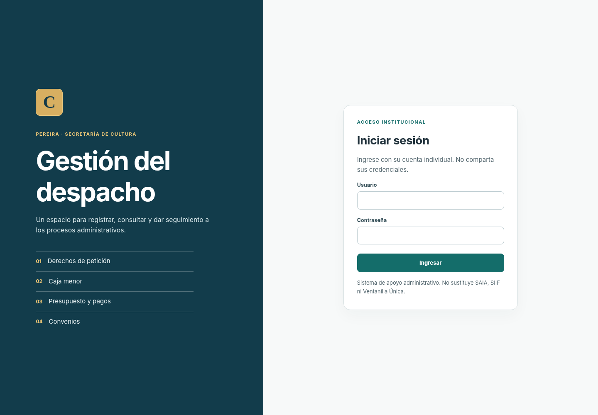
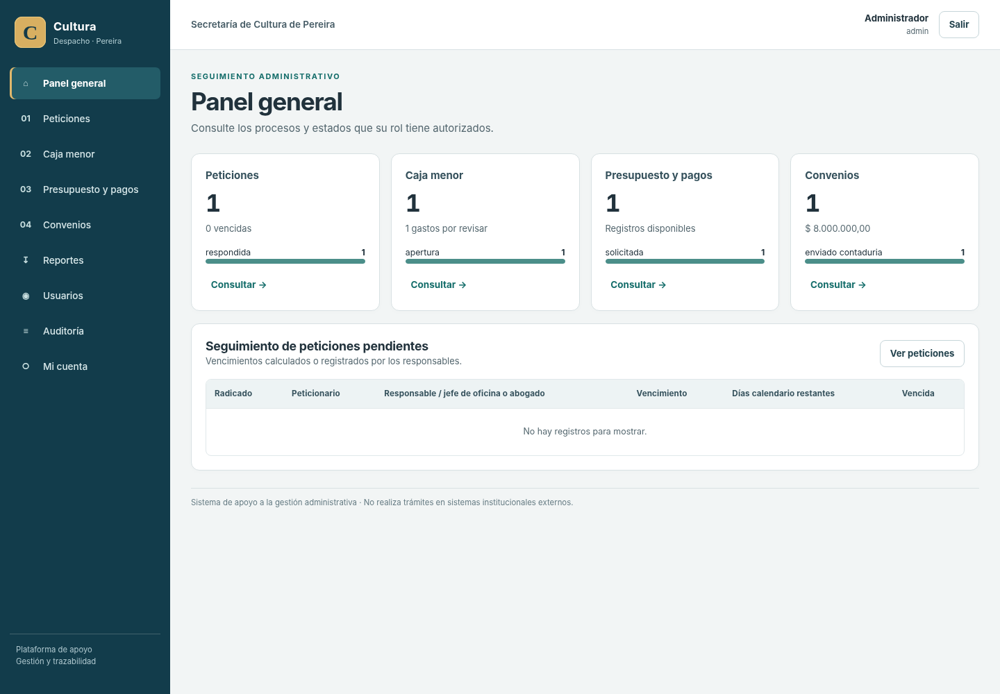
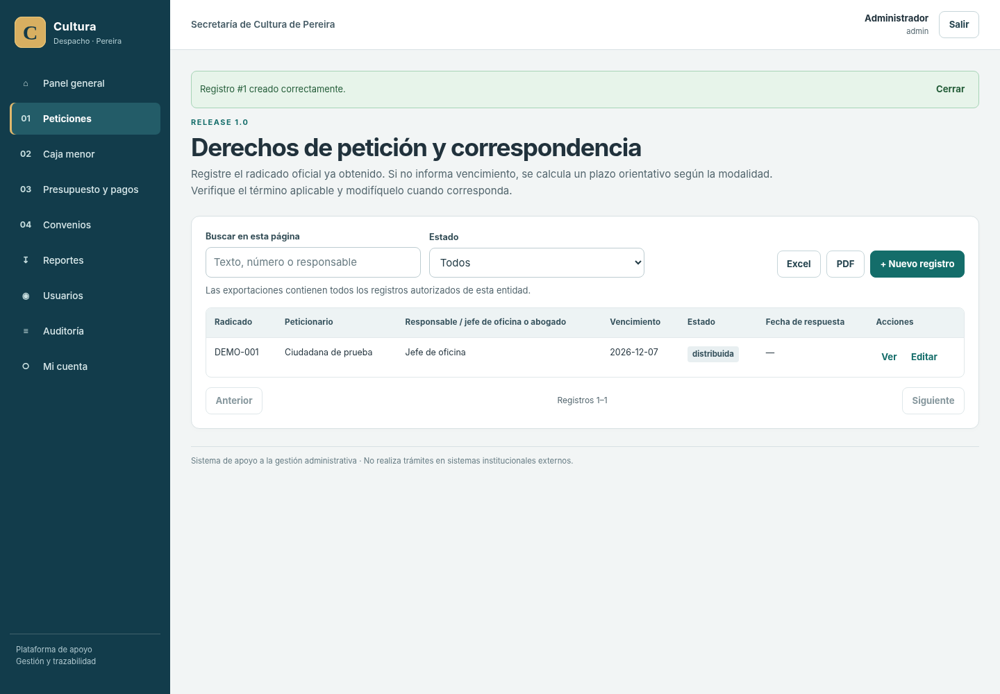
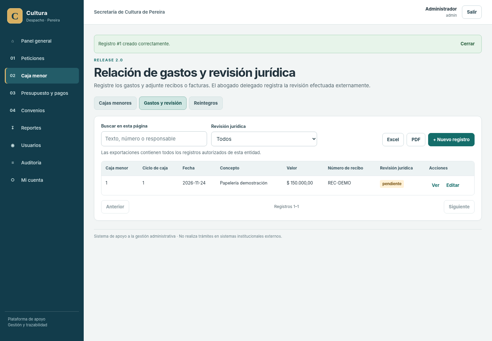
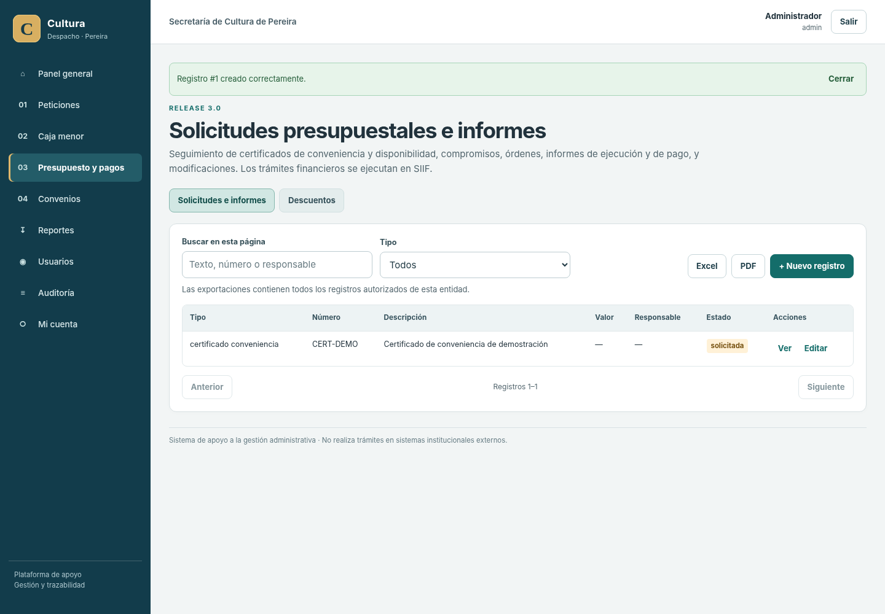
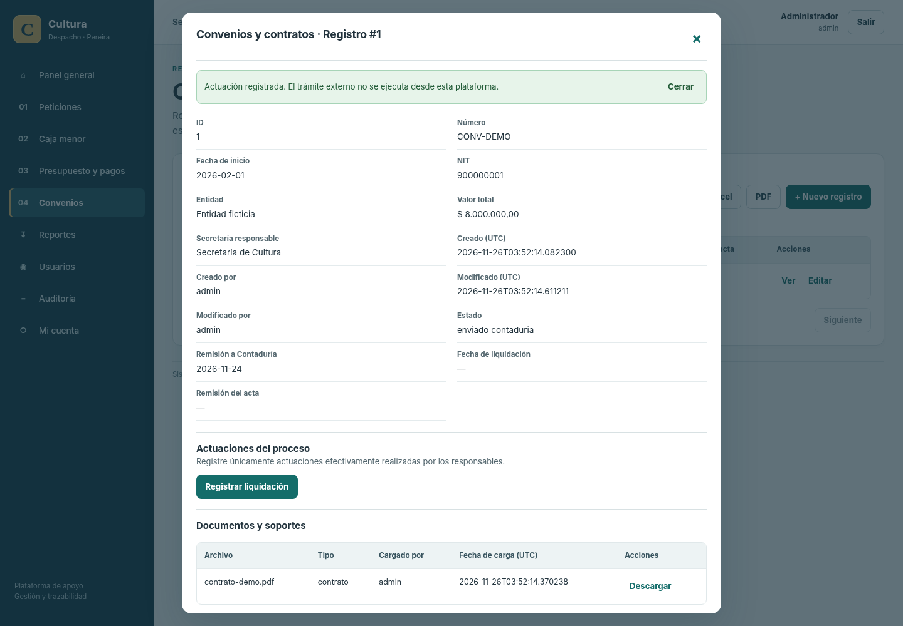
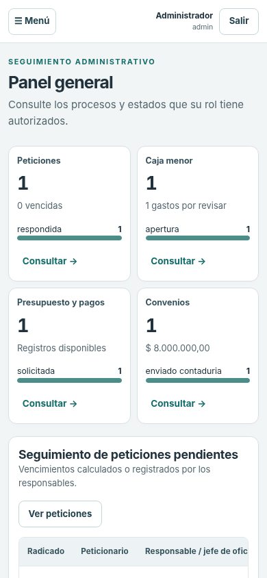

# Manual de usuario
## Plataforma de Gestión del Despacho de la Secretaría de Cultura de Pereira

**Versión candidata 4.0 | Ingeniería de Software III**

Este manual explica el funcionamiento de la interfaz compartida de la plataforma. Las imágenes son capturas reales de la demostración React con datos ficticios; no corresponden a un sitio institucional en producción. Las rutas y acciones previstas son iguales en la arquitectura Spring Boot, que aún debe validarse en staging.

## 1. Ingreso y navegación

Abra la dirección que le proporcione el administrador. Para la demostración local se utiliza http://127.0.0.1:8000; en la instalación objetivo use el dominio HTTPS autorizado. Ingrese su usuario y contraseña personal y pulse Ingresar. Si no tiene credenciales, contacte al administrador. No comparta su cuenta.

Al iniciar sesión encontrará el Panel general. El menú lateral presenta únicamente los módulos permitidos por su rol. En un teléfono pulse Menú para desplegar la navegación. En Mi cuenta podrá cambiar su contraseña; después deberá ingresar nuevamente. Pulse Salir cuando termine de trabajar.

## 2. Derechos de petición y correspondencia — Release 1.0

La Secretaria Ejecutiva continúa revisando el correo y SAIA y obteniendo el radicado oficial mediante Ventanilla Única. La plataforma no genera un radicado oficial ni distribuye físicamente la petición.

1. Abra Peticiones y seleccione Nuevo registro.
2. Diligencie fecha de ingreso, número de radicado, peticionario, solicitud y modalidad. Si existe un plazo particular, indique días hábiles o la fecha de vencimiento real. El cálculo automático es orientativo y considera los festivos nacionales de referencia; confirme el término aplicable.
3. Registre el responsable (jefe de oficina o abogado) después de la distribución efectuada por el funcionario correspondiente. Seleccione el estado recibido, distribuido o en trámite según corresponda.
4. Pulse Guardar registro. Use Ver para consultar el detalle o Editar para actualizar. El radicado no puede repetirse.
5. Revise el seguimiento de peticiones pendientes en Panel general y las fechas de vencimiento en Peticiones. El buscador filtra los registros de la página visible; el filtro Estado consulta la API.
6. Cuando se responda efectivamente, edite el registro, seleccione Respondida y escriba la fecha de respuesta. Puede adjuntar el soporte documental en Ver.

## 3. Caja menor — Release 2.0

Las etapas son apertura, compras, relación de gastos, revisión jurídica, firma, Control Interno, reintegro y cierre. La plataforma solo deja constancia de actuaciones efectuadas por sus responsables. La resolución, revisión, póliza, primer desembolso, firma, aprobación, reintegros y consignaciones se tramitan por los medios institucionales.

En Caja menor, pestaña Cajas menores, seleccione Nuevo registro. Ingrese vigencia, resolución de apertura y valor del fondo. Guarde; podrá asociar la resolución y otros soportes desde Ver. Para pasar a compras, ingrese al detalle y pulse Registrar paso a compras una vez se haya cumplido la actividad correspondiente. Indique fecha, responsable y referencia, luego Confirmar registro.

En la pestaña Gastos y revisión, cree cada gasto asociado a la caja. Indique fecha, concepto, importe, recibo y persona que autorizó la compra. Adjunte factura o recibo desde el detalle. El sistema calcula el saldo y rechaza importes superiores al fondo disponible. Al elaborar la relación, registre los cambios de etapa correspondientes en el detalle de la caja.

El abogado delegado registra la revisión jurídica realizada, editando el gasto en esa etapa; puede dejarlo aprobado o rechazado e incluir observación. No avance a firma si algún gasto permanece pendiente o rechazado; corrija el registro de acuerdo con las actuaciones reales y solicite nueva revisión. El secretario registra la etapa de firma y el auxiliar registra el avance tras la aprobación de Control Interno. Las etapas solo se registran con el rol autorizado.

Cuando se reciba efectivamente el reintegro, vaya a la pestaña Reintegros y cree un registro con caja, fecha, valor, referencia, responsable y soporte. No registre un reintegro si no se ha recibido. El saldo disponible se actualiza con lo reintegrado. Para otro ciclo de compras, desde el detalle de la caja use Iniciar nuevo ciclo de compras, antes de consignar el sobrante. Los gastos de ciclos anteriores quedan protegidos contra modificaciones.

Al finalizar la vigencia, registre en la caja el sobrante realmente consignado y adjunte la consignación. En el detalle seleccione Registrar paso a cierre. Solo podrá cerrar cuando fondo inicial + reintegros – gastos – sobrante sea igual a cero. La caja cerrada no se modifica. Consulte el historial y el resumen de fondo, gastos, reintegros y saldo desde Ver.

## 4. Presupuesto y generación de pagos — Release 3.0

El funcionario continúa elaborando solicitudes y órdenes mediante los procedimientos presupuestales y SIIF. La plataforma registra información y referencias; no ejecuta pagos, compromisos oficiales ni calcula retenciones automáticamente.

Abra Presupuesto y pagos y seleccione Solicitudes e informes. Pulse Nuevo registro y elija el tipo que corresponda: certificado de conveniencia y oportunidad; certificado de disponibilidad presupuestal; compromiso; orden de pago; informe de ejecución; informe de pago; modificación presupuestal. Registre número, descripción, fecha, valor cuando corresponda, referencia SIIF, responsable, estado y observaciones. Guarde, consulte y actualice el estado conforme al trámite efectuado. Adjunte documentos desde Ver.

En Descuentos, seleccione Nuevo registro y elija una orden de pago registrada. Indique el tipo de descuento (retención en la fuente, sobretasa al deporte, estampilla Procultura, industria y comercio o estampilla Prodesarrollo) y el valor informado por el sistema institucional. Guarde. La suma no puede superar el valor registrado de la orden, si fue informado. Consulte los tipos de informe de ejecución y de pago mediante el filtro Tipo.

## 5. Convenios y contratos — Release 4.0

Abra Convenios y seleccione Nuevo registro. Registre número de convenio o contrato, fecha de inicio, NIT, entidad, valor total y Secretaría responsable. Guarde. Desde Ver, adjunte el archivo del contrato con tipo Contrato y los soportes pertinentes. Una vez enviada la copia a la Dirección Operativa de Contaduría por el procedimiento institucional, pulse Registrar remisión a Contaduría e indique fecha, responsable y referencia.

Cuando se realice la liquidación fuera de la plataforma, adjunte el Acta de liquidación y los soportes antes de pulsar Registrar liquidación. Registre la fecha y referencia de la actuación. Cuando se remita el acta a Contaduría, pulse Registrar remisión del acta. Se conservarán las tres fechas del trámite. Los convenios liquidados no admiten edición de sus datos principales. El sistema no remite el contrato ni el acta automáticamente.

## 6. Documentos y soportes

Desde Ver de la petición, caja, gasto, reintegro, solicitud presupuestal o convenio, diríjase a Documentos y soportes. Seleccione el tipo documental, elija un archivo y pulse Adjuntar. Se permiten PDF, PNG, JPG, JPEG, DOCX y XLSX de hasta 10 MB. Para descargar, pulse Descargar en el listado. No adjunte información ajena al trámite ni archivos no autorizados. Los soportes originales que exija la entidad se conservan conforme a sus procedimientos. Una extensión aceptada no significa que el contenido del documento haya sido certificado.

## 7. Panel y reportes administrativos

En Panel general consulte los conteos por estado de los procesos autorizados y las peticiones pendientes/vencidas. Puede ingresar al módulo desde Consultar. La lista del panel muestra un resumen de las primeras peticiones pendientes; consulte el módulo para examinar el resto de registros.

En Reportes elija la información que desea exportar y pulse Descargar Excel (.xlsx) o Descargar PDF. También encontrará estos botones en los módulos. Los archivos contienen todos los registros autorizados de la entidad seleccionada, no únicamente los resultados de búsqueda de la página visible. Consulte o almacene los reportes en medios permitidos por la política de información institucional.

## 8. Acceso desde dispositivos móviles

La interfaz ajusta panel, formularios y navegación al ancho de pantalla. En tablas extensas deslice horizontalmente dentro de la tabla, no la página completa. Pulse Menú para cambiar de módulo y Salir al finalizar. La captura corresponde a Chromium con una vista de 390 píxeles; la compatibilidad final en dispositivos y navegadores institucionales debe probarse en staging.

## 9. Mi cuenta, errores y soporte

Cambie su contraseña en Mi cuenta indicando clave actual y nueva. Debe contener entre 10 y 128 caracteres, mayúscula, minúscula, número y símbolo. Vuelva a ingresar después del cambio. Ante un mensaje de permiso insuficiente, solicite revisión de su rol; no comparta credenciales de otro funcionario. Si aparece un error de registro duplicado, revise el radicado o número del convenio; si la etapa no permite una acción, verifique que los requisitos y soportes se hayan cumplido. Si el archivo no es aceptado, revise extensión y tamaño. Si el sistema no está disponible, comunique el problema al canal institucional de soporte con fecha, módulo y mensaje, sin enviar contraseñas ni datos personales innecesarios.

## 10. Límites de la herramienta

La aplicación no sustituye SAIA, SIIF, Ventanilla Única, correo ni documentos físicos exigidos; tampoco firma, aprueba, liquida jurídicamente, ejecuta desembolsos o responde peticiones en nombre de la Secretaría. La exactitud de los datos, la oportunidad de los registros y la realización de las actuaciones siguen siendo responsabilidad de los funcionarios autorizados.
